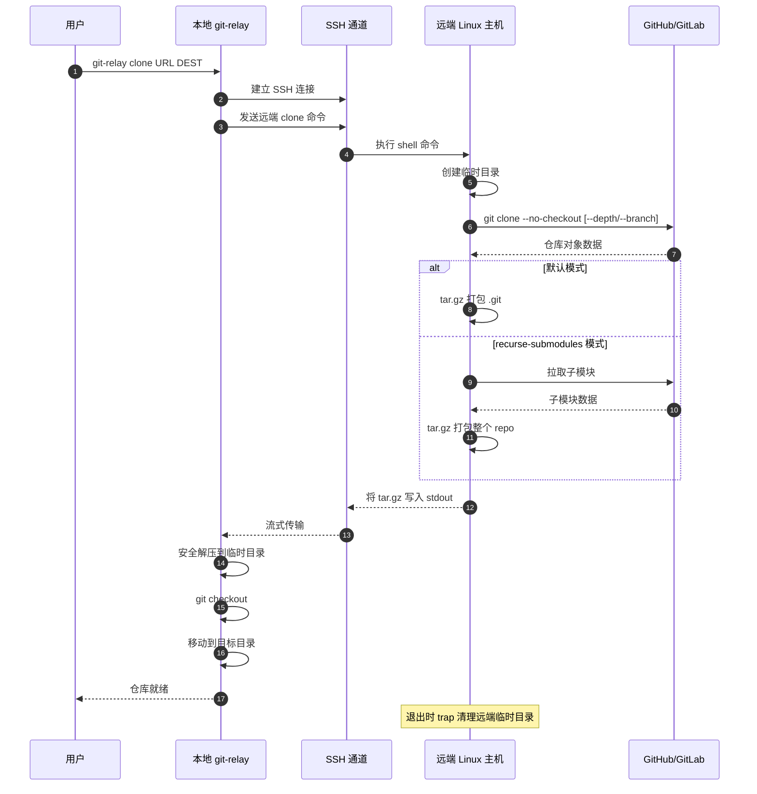

# 工作原理

```text
本地机器                        远端 Linux 主机
   |  ssh 执行 clone 命令  ----->  git clone --no-checkout
   |                               tar.gz 打包 .git
   |  <----- stdout 流式传输 -----
   |  解压 + git checkout
```

- 远端负责访问 GitHub/GitLab，避免本地网络慢。
- 默认只回传 `.git` 目录，源文件在本地 checkout，传输量更小。
- 加 `--recurse-submodules` 时，远端会连同子模块一起 clone，再打包整个仓库回传。
- 不会修改全局 Git 配置，也不会在本地启动代理。

## 时序图



## SSH 后端

- `paramiko`：纯 Python 实现，密码登录稳定，exe 默认内置。
- `openssh`：调用系统 `ssh`；使用密码时通过 `SSH_ASKPASS` 辅助。
- `auto`：有密码且安装了 Paramiko 时优先 Paramiko，否则使用 OpenSSH。

## 限制

- 目前是“克隆加速器”，不是 Git remote helper；已有仓库的增量 `fetch` 仍需手动处理。
- 每次执行会重新在远端 clone；后续可以扩展为远端缓存仓库 + 增量 bundle。
- Git LFS 仓库只回传指针文件；本地 `git checkout` 时仍会直连 GitHub 拉取 LFS 对象，这部分不会被加速。
- 密码只保存在进程内存或环境变量中；图形界面默认不保存密码。
