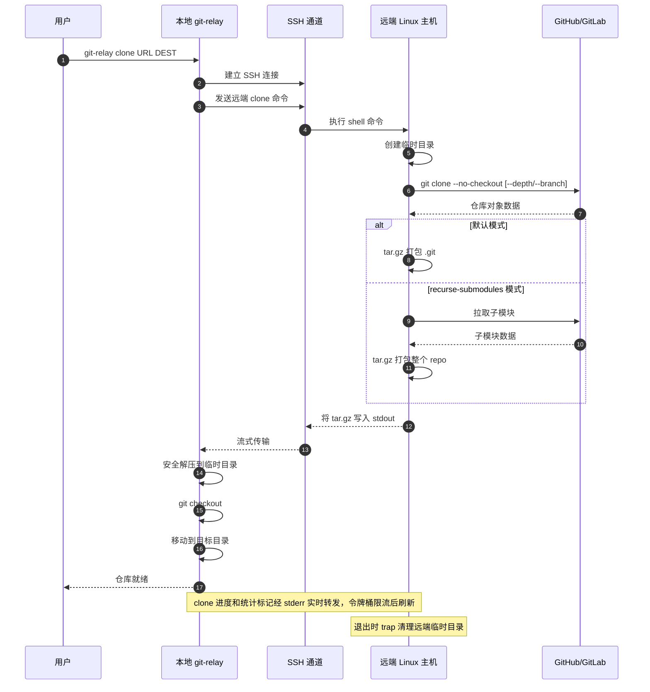

# 工作原理

```text
本地机器                        远端 Linux 主机
   |  ssh 执行 clone 命令  ----->  git clone --no-checkout
   |                               tar.gz 打包 .git
   |  <----- stdout 流式传输 -----
   |  解压 + git checkout
```

- 远端负责访问 GitHub/GitLab，避免本地网络慢。
- 默认只回传 `.git` 目录，源文件在本地 checkout，传输量更小。
- 加 `--recurse-submodules` 时，远端会连同子模块一起 clone，再打包整个仓库回传。
- 不会修改全局 Git 配置，也不会在本地启动代理。

## 时序图



## 进度与速度统计

- 远端 `git clone` 使用 `--progress`，stderr 中的进度经 SSH 实时转发到本地；本地解析 `Receiving objects` 等行，统一成 `clone: ...` 格式。
- 远端在 clone 结束后通过 stderr 发送内部统计标记，包含克隆耗时和仓库大小；该标记不会显示在日志中。
- 本地据此计算远端平均下载速度，并在回传结束后输出远端仓库大小。
- 回传阶段按已接收字节数计算实时速度；本地 checkout 完成后统计目标目录大小。
- 所有进度刷新都经过令牌桶限流（默认 4 次/秒，容量 2）：终端中原地刷新一行，非终端环境（GUI、重定向）逐行输出。
- Paramiko 后端直接读取 SSH 通道的 stderr，OpenSSH 后端使用 `read1`，避免缓冲区等待导致进度滞后。
- SSH 传输中断时（OpenSSH 退出码 255 或 socket 连接错误），clone、子模块回传和 relay fetch 会自动重试一次；重试会重新执行远端 clone，已传输的字节不会续传。

## SSH 后端

- `paramiko`：纯 Python 实现，密码登录稳定，exe 默认内置。
- `openssh`：调用系统 `ssh`；使用密码时通过 `SSH_ASKPASS` 辅助。
- `auto`：有密码且安装了 Paramiko 时优先 Paramiko，否则使用 OpenSSH。

## 同步已有仓库（fetch / pull / push）

`fetch` / `pull` / `push` 支持两种模式（配置 `[git].mode` 或 `--mode`）：

- `relay`（默认）：远端按仓库 URL 维护裸仓库镜像，默认缓存到 `~/.cache/git-relay`，可用 `[git].cache_dir` 修改。
  - fetch：远端先更新镜像，再用 `git bundle create` 把新对象打包；本地已知的跟踪分支和标签作为 bundle 的排除项（`^sha`），因此只回传增量。本地把 bundle fetch 到 `refs/remotes/<remote>/*` 和标签。
  - pull：relay fetch 后对当前分支执行 `git merge --ff-only`；分叉时报错，需手动 merge/rebase。
  - push：本地用 `git bundle create` 生成增量 bundle，经 SSH stdin 上传；远端把 bundle 放进镜像的临时引用，再由镜像推送到 origin，最后清理临时引用。远端主机需要对 origin 具备推送凭据。
- `direct`：直接在本机执行 `git fetch/pull/push`，中转只用于 `clone` 和 `submodules`。

远端 bundle 为空（没有新提交）时返回专用退出码 3，本地显示 “already up to date”。

## 源码目录

`src/` 按平台分成三个包：共用引擎、Linux 命令行、Windows 图形界面。依赖方向只有一个：客户端 → 共用，`common` 不会反向引用 `linux` / `win11`。

```text
src/
├── common/          共用（平台无关）
│   ├── relay_common.py   常量、配置加载、本地 git/解压辅助、日志与进度条
│   ├── relay_ssh.py      SSH 后端、stderr 进度转发、上传/下载与速度统计
│   ├── relay_ops.py      远端命令构建、clone、子模块、fetch/pull/push、环境检查
│   └── toml_parse.py     TOML 读取（tomllib / tomli 兼容层）
├── linux/           Linux 命令行客户端
│   ├── git_relay.py      入口：参数解析、子命令分发
│   └── relay_history.py  命令历史记录
└── win11/           Windows 11 图形界面
    ├── git_relay_gui.py          Tk 终端窗口
    └── git_relay_gui_launcher.py 无控制台入口，启动失败写日志并弹框
```

两个入口脚本都会把 `src/` 自己加进 `sys.path`，因此 `python3 src/linux/git_relay.py`、`script/git-relay`、PyInstaller 打包（`pathex=src`）三种方式都能直接运行，不需要安装成包。

| 文件 | 职责 |
| --- | --- |
| `src/linux/git_relay.py` | 命令行入口：参数解析、子命令分发 |
| `src/linux/relay_history.py` | `history` 子命令的落盘记录 |
| `src/common/relay_common.py` | 常量、配置加载、本地 git/解压辅助、日志与进度条 |
| `src/common/relay_ssh.py` | SSH 后端、stderr 进度转发、上传/下载与速度统计 |
| `src/common/relay_ops.py` | 远端命令构建、clone、子模块、fetch/pull/push、环境检查 |
| `src/common/toml_parse.py` | TOML 解析（标准库 `tomllib`，缺失时退回 `tomli`） |
| `src/win11/git_relay_gui.py` | Tk 图形界面 |
| `src/win11/git_relay_gui_launcher.py` | 图形版打包入口 |

## 限制

- `submodules` 子命令会读取本地仓库的 `origin` 和 `HEAD`，在远端按该提交拉取子模块，只回传子模块工作区和 `.git/modules`，本地再用 `--no-fetch` 完成检出。
- relay 模式的 `push` 依赖远端主机已有的推送凭据；凭据错误时会原样打印远端 git 输出。
- Git LFS 仓库只回传指针文件；本地 `git checkout` 时仍会直连 GitHub 拉取 LFS 对象，这部分不会被加速。
- 密码只保存在进程内存或环境变量中；图形界面默认不保存密码。
